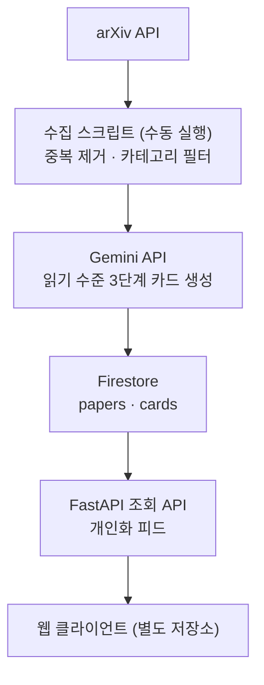

# CLAUDE.md

이 파일은 Claude Code가 **논스톱(NonStop) 백엔드 저장소**에서 작업할 때 따라야 할 지침이다.

- **기준 문서:** 이 파일과 [docs/spec.md](docs/spec.md)(기능 명세, 비기능 요구사항, 구현 정책, 릴리스 계획). 기능이나 정책을 다룰 때는 `docs/spec.md`를 먼저 읽는다. 초기 초안인 `개발문서` v1.0은 기준 문서가 아니다.
- **저장소 구성:** 백엔드와 프론트엔드는 별도 저장소다. 이 저장소는 백엔드(FastAPI, 수집 배치, Firebase Admin 연동)만 다룬다. 프론트엔드 화면 · 제스처 · UI 작업은 하지 않으며, 프론트엔드와의 계약(API 명세, 인증 방식)은 `openapi.yaml`로 관리한다.
- **현재 상태:** `openapi.yaml` 기준 API 6개 구현 완료. Firestore에 데모용 논문 120편(정상 79편) 저장 완료. 결정 기록은 [docs/decisions.md](docs/decisions.md)에 둔다.

## 프로젝트 개요

**논스톱(NonStop)** 은 arXiv 논문을 매일 수집하고 Gemini로 카드뉴스 형태로 재구성해 전달하는 웹 서비스다. 슬로건은 "매일 멈추지 않는 논문 루틴"이다. 백엔드는 논문 수집, 읽기 수준 3단계(쉽게 · 기본 · 전문) 카드 생성, 개인화 피드 API를 맡는다.

현재 범위는 2026 ITM전공 IT 서비스 공모전 출품용 데모다 (운영 기간 2026-11-08 ~ 2026-11-30). 1차 타깃은 IT 관련 분야 학부생과 대학원생이다.

| 항목 | 내용 |
| --- | --- |
| 클라이언트 | 웹 (별도 저장소) |
| 백엔드 | FastAPI (Python) |
| 인프라 | Firebase (Firestore, Hosting) |
| 호스팅 | Render 무료 웹 서비스 (발표 전 수동 접속으로 콜드 스타트 해소) |
| 콘텐츠 생성 | Gemini API (`google-genai` 패키지, 지원 종료된 `google-generativeai`는 쓰지 않음) |
| 원천 데이터 | arXiv API |
| 사용자 데이터 | 브라우저 로컬 저장소. 서버에 저장하지 않음 |
| 사용자 노출 문자열 | 한국어 단독 |
| 개발 환경 | Python 3.12, uv, `app/` 패키지 구조, pytest, Ruff (린트와 포맷) |

- Firebase Crashlytics는 웹을 지원하지 않아서 뺐다.
- Firebase Storage는 무료(Spark) 요금제에서 쓸 수 없어서 뺐다. 파일 저장이 필요해지면 사용자에게 먼저 확인한다.

## 무료 티어 운영 원칙

모든 서비스는 무료 티어 안에서만 운영한다.

- Firebase 요금제는 **Spark로 확정했다.** Spark에서는 Cloud Run, Cloud Functions, Cloud Storage를 쓸 수 없으므로 이들에 의존하는 코드를 작성하지 않는다.
- 각 서비스의 무료 한도(Firestore 일일 읽기 · 쓰기 · 삭제 건수, 저장 용량, Gemini 호출 한도 등)는 바뀔 수 있다. 기억에 의존한 수치를 하드코딩하지 말고, 공식 문서를 확인해서 설정값으로 분리한다.
- Gemini 무료 한도는 모델 · 사용 등급 · 계정 상태에 따라 다르므로 AI Studio에서 확인한다. 무료 티어에서는 Pro 모델을 쓸 수 없으니 Flash 계열을 기본으로 하고, 모델명은 설정값으로 분리한다.
- Firestore 무료 쓰기 한도를 고려해, 요청 하나가 여러 번 쓰기를 일으키는 설계를 피하고 가능한 곳은 묶어서 쓴다.
- 무료 티어에서는 Google이 Gemini 입력과 출력을 제품 개선에 쓸 수 있고 사람이 검토할 수 있다. 챗봇 요청에 사용자 식별 정보(이메일, 닉네임, uid 등)를 넣지 않는다.
- 무료 티어에서 Gemini Batch 모드를 쓸 수 있는지는 확인되지 않았다. 확인 전까지 Batch 모드에 의존하는 설계를 하지 않는다.

## 절대 규칙

1. **Gemini API 키는 백엔드에만 둔다.** 키는 서버 환경 변수나 CI 시크릿으로만 주입하고, 코드 · 로그 · 응답 · 저장소에 남기지 않는다. 카드 생성과 챗봇을 포함한 모든 Gemini 호출은 이 저장소의 코드에서만 일어난다.
2. **Firebase 서비스 계정 키를 저장소에 커밋하지 않는다.** 환경 변수나 시크릿으로만 주입한다.
3. **논문 원문과 초록 전문을 재현하지 않는다.** 카드 본문은 Gemini가 재구성한 생성물이어야 하고, 생성 프롬프트에 원문 표현을 그대로 옮기지 않도록 제약을 명시한다.
4. **PDF를 저장 · 미러링 · 프록시하지 않는다.** 원문 보기는 프론트엔드가 arXiv 페이지를 새 탭으로 여는 방식으로만 처리하고, API는 `abstractUrl`, `pdfUrl` 링크만 내려준다.
5. **AI 생성 카드와 운영자 작성물을 섞지 않는다.** 카드 필드에는 AI 생성 결과만 담아 프론트엔드가 항상 "AI 요약"으로 표시할 수 있게 한다. 편집팀 해설(`editorNote`)은 데모 범위 외다.
6. **생성 프롬프트 제약:** 초록에 없는 수치 생성 금지, 단정적인 성과 표현 회피, 확인할 수 없는 내용은 생략한다.
7. **사용자 식별 정보와 이용 이벤트를 서버에 저장하지 않는다.** 관심 키워드 · 저장 목록 · 출석 기록은 클라이언트가 브라우저에 저장하고, 서버는 요청에 실려 온 값을 계산에만 쓰고 보관하지 않는다.
8. **`/internal/*` 엔드포인트를 두지 않는다.** 수집과 카드 생성은 스크립트가 Admin SDK로 Firestore에 직접 쓴다.
9. 아래 "제외 범위"에 있는 기능은 명시적인 지시 없이 구현하지 않는다.
10. **`main`에 직접 커밋하지 않는다.** 모든 변경은 작업 브랜치에서 PR로 병합한다.

## 제외 범위 (확정)

- 커뮤니티 · 게시판 · 사용자 댓글
- 레벨 등 게이미피케이션 (출석 스트릭은 2026-11-07 제외 범위에서 해제)
- 읽기 기록 및 통계
- 홈 이어보기 섹션
- 결제 · 구독
- PDF 저장 · 미러링
- 다국어

### 데모 범위 외 (공모전 이후 재검토)

- 로그인 · 회원 계정 (구글, 카카오), 둘러보기 구분
- 알림 발송 (웹 푸시, FCM)
- 검색, 챗봇, 폴더, 좋아요
- 개정판 재생성, 편집팀 해설, 인기도 산정

## 시스템 구조



## 인증과 사용자 데이터

인증이 없다. 모든 API는 토큰 없이 호출한다.

- 사용자 데이터는 클라이언트가 브라우저 로컬 저장소에 둔다.
  - `nonstop:v1:profile`: 관심 키워드와 가중치, 기본 읽기 수준
  - `nonstop:v1:saves`: 저장한 paperId 목록
  - `nonstop:v1:streak`: 현재 일수, 최장 일수, 마지막 인정일, 최근 7일 날짜
- 개인화가 필요한 API는 관심 키워드와 가중치를 요청 파라미터로 받는다. 서버는 이 값을 로그에 남기지 않는다.
- 출석 스트릭은 클라이언트가 판정한다. 기준은 "한국 시간 기준 그날 논문 상세를 한 번 이상 열면 인정"이다. 날짜는 기기 시계 대신 `GET /v1/home` 응답의 `today`(한국 날짜, YYYY-MM-DD)를 쓴다. HTTP `Date` 헤더는 CORS 기본 노출 헤더가 아니므로 쓰지 않는다.

## 데이터 모델 (Firestore)

```
papers/{paperId}
  arxivId, version, title, titleKo, authors, publishedAt, categories,
  primaryCategory, venue, abstractUrl, pdfUrl, license, tags[], status

papers/{paperId}/cards/{level}      level = easy | basic | expert
  oneLine, whyImportant, keyPoints[], method, dataset, limitation,
  model, promptVersion, generatedAt
```

- 노출 범위를 조정할 수 있도록 논문별 `license`를 반드시 저장한다.
- 생성된 모든 카드에 `model`과 `promptVersion`을 기록한다.
- `paperId`는 버전을 뺀 arXiv ID이며, 구형 ID의 `/`는 `_`로 바꾼다 (예: `hep-th_9901001`). 버전은 `version` 필드에 둔다.
- `status`는 `ready`, `hidden` 두 값만 쓴다.
- Firestore 보안 규칙은 클라이언트 접근을 전면 차단한다 (`allow read, write: if false`). 모든 접근은 백엔드의 Admin SDK로만 한다.
- `titleKo`는 Gemini가 만든 한국어 제목이며 세 읽기 수준이 공유한다.
- `venue`는 arXiv `journal_ref`에서만 가져오고 없으면 null이다. AI로 생성하지 않는다.
- `tags[]`에는 `openapi.yaml`의 `KeywordSlug` 값만 최대 3개 저장한다.

## API 엔드포인트 (FastAPI)

- 전체 OpenAPI 3.1 명세는 `openapi.yaml`로 관리하고 Swagger Editor에서 검증한다. 엔드포인트를 바꾸면 이 파일도 같이 갱신하고, 프론트엔드와의 계약이므로 사용자에게 알린다.
- 웹 클라이언트와 API의 출처가 다르면 CORS 설정이 필요하다. 허용 출처는 와일드카드 없이 설정값으로 명시한다. 허용 출처는 Firebase Hosting 기본 도메인(`.web.app`, `.firebaseapp.com`)과 개발용 `http://localhost:5173`이다.
- 요청 파라미터 형식, 응답 필드, 오류 코드는 `openapi.yaml`이 기준이다. `interests`, `exclude` 값은 로그에 남기지 않는다.

| 메서드 | 경로 | 설명 |
| --- | --- | --- |
| GET | /v1/onboarding/cards | 온보딩 스와이프용 카드 10장 |
| POST | /v1/onboarding/weights | 선택 분야와 스와이프 결과로 키워드 가중치 계산 후 반환 (저장 없음) |
| GET | /v1/home | 오늘의 논문, 추천 목록, `today`. 관심 키워드와 이미 읽은 paperId를 파라미터로 받음 |
| GET | /v1/feed | 관심 키워드 기반 피드 (커서 페이지네이션) |
| GET | /v1/papers/{paperId} | 논문 상세 (`level` 파라미터) |
| GET | /v1/papers | 저장함 표시용, `ids` 파라미터로 여러 논문 한 번에 조회 |

- 공통 오류 응답은 RFC 9457 Problem Details(`application/problem+json`)에 `code` 확장 필드를 더한 형식으로 한다.

## 실행 명령

- 로컬 서버: `uv run uvicorn app.main:app --reload --no-access-log`
- 검사: `uv run ruff check .`, `uv run ruff format --check .`, `uv run pytest`
- 스크립트 (backfill, recheck, regenerate는 `--dry-run`으로 먼저 확인한다)
  - `uv run python -m scripts.check_firestore`: Admin SDK 연결 확인 (확인용 문서 쓰기 · 읽기 · 삭제)
  - `uv run python -m scripts.backfill --model <모델>`: 분야별 최신 논문을 골라 카드 생성 후 저장. 이미 저장된 논문은 건너뛴다
  - `uv run python -m scripts.recheck`: 저장된 카드에 현재 점검기를 다시 돌려 status 갱신. Gemini를 부르지 않는다
  - `uv run python -m scripts.regenerate --model <모델>`: hidden 논문을 최신 프롬프트로 다시 생성하고, 통과하면 ready로 바꾼다

## 배포 (Render)

- 빌드 명령 `uv sync --locked --no-dev`, 시작 명령 `uv run --no-dev uvicorn app.main:app --host 0.0.0.0 --port $PORT --no-access-log`
- 지역 Singapore, 무료 인스턴스, 브랜치 `main`
- 환경 변수: `PYTHON_VERSION`, `APP_ENV`, `FIREBASE_PROJECT_ID`, `FIREBASE_SERVICE_ACCOUNT_JSON`, `CORS_ALLOWED_ORIGINS`. API 서버는 Gemini를 부르지 않으므로 Gemini 키는 넣지 않는다.
- 서버가 깨어난 뒤 첫 요청에서 Firestore의 ready 논문과 카드를 한 번 읽어 메모리에 둔다. 백필 · 재생성 · 재점검으로 데이터를 바꾼 뒤에는 서버를 다시 시작해야 반영된다.

## 브랜치 전략 (GitHub Flow)

- 최신 `main`에서 논리 작업 하나당 브랜치 하나를 따고, 이름은 `<type>/<short-description>`으로 쓴다. type은 Conventional Commits와 같다. 예: `feat/kakao-auth`. 커밋을 추천할 때 현재 브랜치가 `main`이면 브랜치 생성부터 안내한다.
- PR은 리뷰 승인 없이 작성자가 직접 병합한다. 성격별로 나눈 커밋을 그대로 남기기 위해 merge commit을 쓴다. 병합한 브랜치는 삭제하지 않아도 된다.
- `develop`, `release`, `hotfix` 브랜치는 두지 않는다. 긴급 수정도 `fix/` 브랜치와 PR을 거치며, `main`은 항상 배포 가능한 상태로 유지한다.

## 오픈 이슈

아래 항목은 미정이다. 값이나 방식을 임의로 정하지 말고, 코드에 필요하면 설정값이나 플레이스홀더로 처리한 뒤 사용자에게 알린다. 관련 구현 전에는 사용자에게 먼저 확인한다.

### 운영 · 인프라

7. Crashlytics를 대체할 오류 수집 도구 (데모 범위 외)
8. API 응답 성능 기준과 안정성 지표 재정의 (무료 호스팅 콜드 스타트 고려) (데모 범위 외)

### API · 데이터 모델

19. 좋아요 엔드포인트와 데이터 모델 (데모 범위 외)
24. 재생성 큐와 실패 큐의 저장 위치 (데모 범위 외)
27. 검색 구현 방식 ([docs/spec.md](docs/spec.md) 참고) (데모 범위 외)

### 콘텐츠 · 정책

32. `popularityScore` 산정 방식 (데모 범위 외)
33. 챗봇 일일 질문 상한값 (데모 범위 외)
34. 편집팀 해설 운영 커버리지 (등록 비율) (데모 범위 외)
36. 성공 지표 목표 수치 (2주 클로즈드 베타 후 확정) (데모 범위 외)
