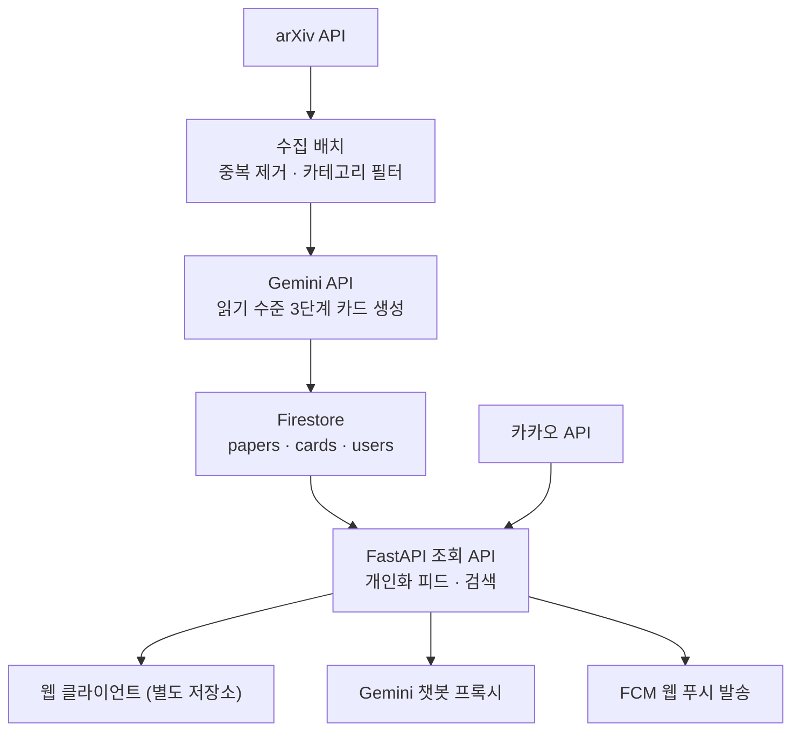

# CLAUDE.md

이 파일은 Claude Code가 **논스톱(NonStop) 백엔드 저장소**에서 작업할 때 따라야 할 지침이다.

- **기준 문서:** 이 파일과 [docs/spec.md](docs/spec.md)(기능 명세, 비기능 요구사항, 구현 정책, 릴리스 계획). 기능이나 정책을 다룰 때는 `docs/spec.md`를 먼저 읽는다. 초기 초안인 `개발문서` v1.0은 기준 문서가 아니다.
- **저장소 구성:** 백엔드와 프론트엔드는 별도 저장소다. 이 저장소는 백엔드(FastAPI, 수집 배치, Firebase Admin 연동)만 다룬다. 프론트엔드 화면 · 제스처 · UI 작업은 하지 않으며, 프론트엔드와의 계약(API 명세, 인증 방식)은 `openapi.yaml`로 관리한다.
- **현재 상태:** 구현 코드가 없다. `openapi.yaml`과 `.env.example`도 아직 없다.

## 프로젝트 개요

**논스톱(NonStop)** 은 arXiv 논문을 매일 수집하고 Gemini로 카드뉴스 형태로 재구성해 전달하는 웹 서비스다. 슬로건은 "매일 멈추지 않는 논문 루틴"이다. 백엔드는 논문 수집, 읽기 수준 3단계(쉽게 · 기본 · 전문) 카드 생성, 개인화 피드 · 검색 API, 인증 토큰 검증, 웹 푸시 발송을 맡는다.

| 항목 | 내용 |
| --- | --- |
| 클라이언트 | 웹 (별도 저장소) |
| 백엔드 | FastAPI (Python) |
| 인프라 | Firebase (Auth, Firestore, FCM) |
| 콘텐츠 생성 | Gemini API (`google-genai` 패키지, 지원 종료된 `google-generativeai`는 쓰지 않음) |
| 원천 데이터 | arXiv API |
| 사용자 노출 문자열 | 한국어 단독 |

- Firebase Crashlytics는 웹을 지원하지 않아서 뺐다.
- Firebase Storage는 무료(Spark) 요금제에서 쓸 수 없어서 뺐다. 파일 저장이 필요해지면 사용자에게 먼저 확인한다.

## 무료 티어 운영 원칙

모든 서비스는 무료 티어 안에서만 운영한다.

- Firebase 요금제 확정 전까지는 **Spark에서 동작하는 구성을 기본 가정**으로 한다. Spark에서는 Cloud Run, Cloud Functions, Cloud Storage를 쓸 수 없으므로 이들에 의존하는 코드를 작성하지 않는다.
- 각 서비스의 무료 한도(Firestore 일일 읽기 · 쓰기 · 삭제 건수, 저장 용량, Gemini 호출 한도 등)는 바뀔 수 있다. 기억에 의존한 수치를 하드코딩하지 말고, 공식 문서를 확인해서 설정값으로 분리한다.
- Gemini 무료 한도는 모델 · 사용 등급 · 계정 상태에 따라 다르므로 AI Studio에서 확인한다. 무료 티어에서는 Pro 모델을 쓸 수 없으니 Flash 계열을 기본으로 하고, 모델명은 설정값으로 분리한다.
- Firestore 무료 쓰기 한도를 고려해, 요청 하나가 여러 번 쓰기를 일으키는 설계를 피하고 가능한 곳은 묶어서 쓴다.
- 무료 티어에서는 Google이 Gemini 입력과 출력을 제품 개선에 쓸 수 있고 사람이 검토할 수 있다. 챗봇 요청에 사용자 식별 정보(이메일, 닉네임, uid 등)를 넣지 않는다.
- 무료 티어에서 Gemini Batch 모드를 쓸 수 있는지는 확인되지 않았다. 확인 전까지 Batch 모드에 의존하는 설계를 하지 않는다.

## 절대 규칙

1. **Gemini API 키는 백엔드에만 둔다.** 키는 서버 환경 변수나 CI 시크릿으로만 주입하고, 코드 · 로그 · 응답 · 저장소에 남기지 않는다. 카드 생성과 챗봇을 포함한 모든 Gemini 호출은 이 저장소의 코드에서만 일어난다.
2. **Firebase 서비스 계정 키를 저장소에 커밋하지 않는다.** 환경 변수나 시크릿으로만 주입한다.
3. **논문 원문과 초록 전문을 재현하지 않는다.** 카드 본문은 Gemini가 재구성한 생성물이어야 하고, 생성 프롬프트에 원문 표현을 그대로 옮기지 않도록 제약을 명시한다.
4. **PDF를 저장 · 미러링 · 프록시하지 않는다.** 원문 보기는 프론트엔드가 arXiv 페이지를 새 탭으로 여는 방식으로만 처리하고, API는 `abstractUrl`, `pdfUrl` 링크만 내려준다.
5. **AI 요약과 편집팀 해설을 데이터로 구분한다.** API 응답에서 AI 생성 카드와 `editorNote`(운영자 작성물)를 별도 필드로 내려서 프론트엔드가 구분 표기할 수 있게 한다.
6. **생성 프롬프트 제약:** 초록에 없는 수치 생성 금지, 단정적인 성과 표현 회피, 확인할 수 없는 내용은 생략한다.
7. **열람 · 스와이프 이벤트 로그는 별도 저장소에 보관하고, 클라이언트 조회 API를 열지 않는다.**
8. **내부용 작업(수집, 재생성)은 클라이언트 토큰으로 접근할 수 없어야 한다.**
9. 아래 "제외 범위"에 있는 기능은 명시적인 지시 없이 구현하지 않는다.
10. **`main`에 직접 커밋하지 않는다.** 모든 변경은 작업 브랜치에서 PR로 병합한다.

## 제외 범위 (확정)

- 커뮤니티 · 게시판 · 사용자 댓글
- 출석 · 레벨 등 게이미피케이션
- 읽기 기록 및 통계
- 홈 이어보기 섹션
- 결제 · 구독
- PDF 저장 · 미러링
- 다국어

## 시스템 구조



## 인증 · 회원가입

소셜 로그인만 쓰므로 별도 가입 폼은 없다. **처음 로그인하는 순간이 곧 가입**이다.

- **공통 인증:** 클라이언트는 Firebase ID Token을 `Authorization: Bearer <token>`으로 넘기고, FastAPI가 Firebase Admin SDK로 검증한다. 실패하면 401을 반환하며, 서버에서 토큰 갱신을 시도하지 않는다.
- **구글 로그인:** 클라이언트가 Firebase Auth의 Google 제공자로 직접 로그인한다. 백엔드는 ID Token 검증만 한다.
- **둘러보기:** 홈 · 피드 열람까지만 허용한다.

### 카카오 로그인

1. 클라이언트가 카카오 JavaScript SDK로 카카오 액세스 토큰을 받아 `POST /v1/auth/kakao`로 보낸다.
2. 백엔드가 카카오 API로 토큰을 검증하고 카카오 사용자 ID를 확인한다.
3. 백엔드가 Admin SDK로 Custom Token을 발급한다. uid는 `kakao:{kakaoUserId}` 형식으로 한다.
4. 클라이언트가 `signInWithCustomToken`으로 로그인한다. 이후 요청은 공통 인증을 따른다.

- Firebase의 OIDC 공급자 방식은 Identity Platform 업그레이드가 필요하고 무료 조건에서의 한도가 확인되지 않아서 쓰지 않는다.
- 카카오 액세스 토큰은 검증에만 쓰고 저장하지 않는다.
- 카카오 동의 항목 값(이메일, 연령대 등)이 항상 온다고 가정하지 않는다.

### 최초 가입 처리

- 로그인 후 `users/{uid}` 문서가 없으면 신규 가입자로 본다.
- 가입 완료 처리 시 이용약관 · 개인정보처리방침 동의 여부와 만 14세 이상 확인 여부를 받아 검증한다. 만 14세 미만이면 가입을 거부한다(법정대리인 동의 절차 없음).
- 검증을 통과하면 `users/{uid}` 문서를 만든다. 문서 생성 전에는 저장 · 키워드 등 회원 전용 API를 거부한다.

## 데이터 모델 (Firestore)

```
papers/{paperId}
  arxivId, version, title, authors, publishedAt, categories,
  abstractUrl, pdfUrl, license, tags[], status,
  editorNote, popularityScore

papers/{paperId}/cards/{level}      level = easy | basic | expert
  oneLine, whyImportant, keyPoints[], method, dataset, limitation,
  model, promptVersion, generatedAt

users/{uid}
  nickname, provider, defaultLevel,
  notificationEnabled, notifyHour, createdAt

users/{uid}/keywords/{keyword}      weight, source (manual | inferred)
users/{uid}/saves/{paperId}         savedAt, folderId
users/{uid}/folders/{folderId}      name, order, createdAt
```

- 노출 범위를 조정할 수 있도록 논문별 `license`를 반드시 저장한다.
- 생성된 모든 카드에 `model`과 `promptVersion`을 기록한다.

## API 엔드포인트 (FastAPI)

- 전체 OpenAPI 3.1 명세는 `openapi.yaml`로 관리하고 Swagger Editor에서 검증한다. 엔드포인트를 바꾸면 이 파일도 같이 갱신하고, 프론트엔드와의 계약이므로 사용자에게 알린다.
- 웹 클라이언트와 API의 출처가 다르면 CORS 설정이 필요하다. 허용 출처는 와일드카드 없이 설정값으로 명시한다.

| 메서드 | 경로 | 설명 |
| --- | --- | --- |
| POST | /v1/auth/kakao | 카카오 토큰 검증 후 Firebase Custom Token 발급 |
| GET | /v1/home | 홈 섹션 묶음 조회 |
| GET | /v1/feed | 개인화 피드 (커서 페이지네이션) |
| GET | /v1/papers/{paperId} | 논문 상세 (`level` 파라미터) |
| GET | /v1/search | 논문 검색 |
| POST | /v1/onboarding/preferences | 온보딩 결과 저장 |
| GET · PUT | /v1/me/settings | 사용자 설정 조회 · 변경 |
| GET · POST · DELETE | /v1/me/keywords | 관심 키워드 관리 |
| GET · POST · DELETE | /v1/me/saves | 저장함 관리 |
| GET · POST · PATCH · DELETE | /v1/me/folders | 폴더 CRUD |
| POST | /v1/papers/{paperId}/chat | 논문 기반 질의응답 |
| POST | /v1/events | 개인화용 이벤트 수집 |
| POST | /internal/ingest | 수집 배치 트리거 (내부) |
| POST | /internal/regenerate | 카드 재생성 (내부) |

## 브랜치 전략 (GitHub Flow)

- 최신 `main`에서 논리 작업 하나당 브랜치 하나를 따고, 이름은 `<type>/<short-description>`으로 쓴다. type은 Conventional Commits와 같다. 예: `feat/kakao-auth`. 커밋을 추천할 때 현재 브랜치가 `main`이면 브랜치 생성부터 안내한다.
- PR은 리뷰 승인 없이 작성자가 직접 병합한다. 성격별로 나눈 커밋을 그대로 남기기 위해 merge commit을 쓴다. 병합한 브랜치는 삭제하지 않아도 된다.
- `develop`, `release`, `hotfix` 브랜치는 두지 않는다. 긴급 수정도 `fix/` 브랜치와 PR을 거치며, `main`은 항상 배포 가능한 상태로 유지한다.

## 오픈 이슈

아래 항목은 미정이다. 값이나 방식을 임의로 정하지 말고, 코드에 필요하면 설정값이나 플레이스홀더로 처리한 뒤 사용자에게 알린다. 관련 구현 전에는 사용자에게 먼저 확인한다.

### 운영 · 인프라

1. Firebase 요금제 (Spark 또는 Blaze 무료 할당량 내 사용)
2. FastAPI 호스팅 환경과 배포 방식 (후보: Render 무료 웹 서비스)
3. 수집 배치와 알림 스케줄러 실행 환경 (후보: GitHub Actions 예약 워크플로에서 Admin SDK로 Firestore에 직접 쓰기. 이 경우 `/internal/ingest`를 외부에 열 필요가 없음)
4. `/internal/*` 보호 방식 (공유 시크릿, 서명 등. 배치 실행 환경이 정해진 뒤 결정)
5. 허용할 CORS 출처 (프론트엔드 배포 주소)
6. 이벤트 로그 저장소와 묶음 저장 방식 (Firestore 무료 쓰기 한도를 빠르게 소진할 수 있음)
7. Crashlytics를 대체할 오류 수집 도구
8. API 응답 성능 기준과 안정성 지표 재정의 (무료 호스팅 콜드 스타트 고려)
9. 개발 환경: Python 버전, 패키지 관리자, 프로젝트 구조, 테스트 전략, 린트 설정, 빌드 · 실행 · 테스트 명령어
10. 환경 변수 이름 목록 (확정되면 `.env.example`에 키 이름만 적고 값은 비워 둔다)

### 인증 · 개인정보

11. 둘러보기 방식 (비로그인 허용 또는 익명 인증)
12. 최초 가입 처리 엔드포인트와 요청 형식, 약관 동의 · 연령 확인 기록 저장 위치
13. 동일 이메일 · 복수 소셜 계정 연결 규칙 (임의로 구현하지 않음)
14. 카카오 동의 항목 (이메일, 연령대 등)과 심사 필요 여부
15. 회원 탈퇴 엔드포인트와 2단계 확인의 서버 처리 방식
16. 이메일 저장 여부와 위치 (수집 항목에 있지만 `users` 모델에 필드가 없음)
17. 이벤트 보유 기간
18. Firestore 보안 규칙 (클라이언트 직접 접근을 모두 막을지)

### API · 데이터 모델

19. 좋아요 엔드포인트와 데이터 모델
20. 웹 푸시 토큰 등록 엔드포인트와 저장 위치
21. 개인화 끄기 · 광고성 수신 동의 필드
22. `paperId` 형식 (버전 포함 여부. 구형 arXiv ID의 `/`는 Firestore 문서 ID에 쓸 수 없음)
23. 키워드 문서 ID 변환 규칙 (키워드에 `/`가 포함될 수 있음)
24. 재생성 큐와 실패 큐의 저장 위치
25. 논문 `status` 값 목록
26. 공통 오류 응답 형식
27. 검색 구현 방식 ([docs/spec.md](docs/spec.md) 참고)

### 콘텐츠 · 정책

28. arXiv 카테고리 화이트리스트
29. 일일 수집 상한 건수
30. arXiv API 이용 약관 최신본 확인
31. 오늘의 대표 논문 선정 기준
32. `popularityScore` 산정 방식
33. 챗봇 일일 질문 상한값
34. 편집팀 해설 운영 커버리지 (등록 비율)
35. 알림 문구 법무 검토
36. 성공 지표 목표 수치 (2주 클로즈드 베타 후 확정)
